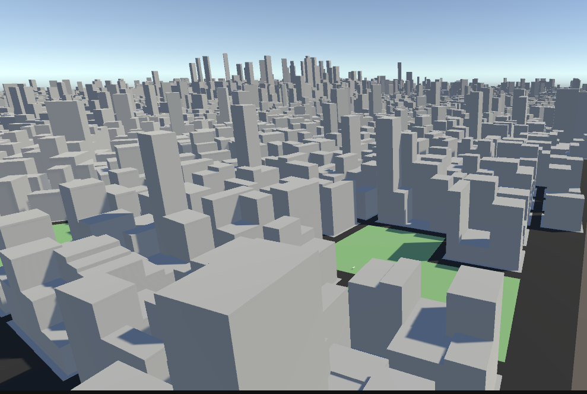
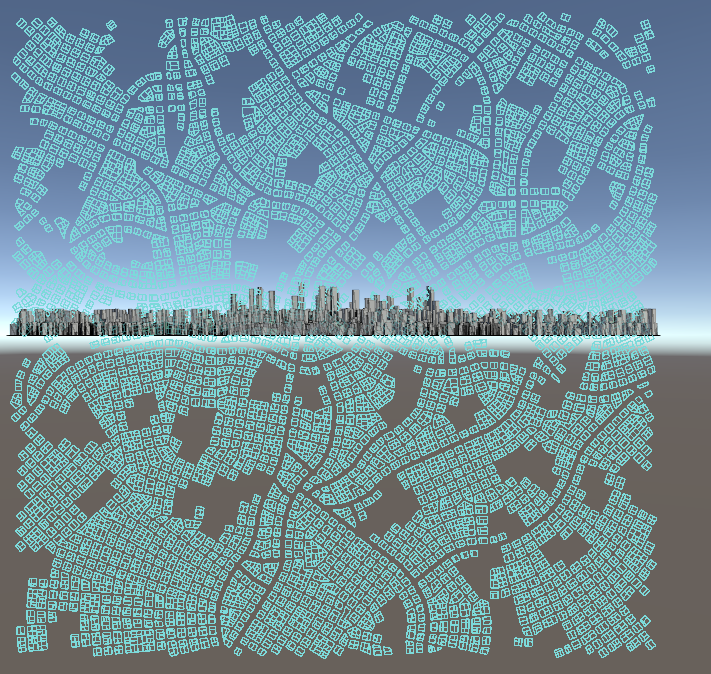
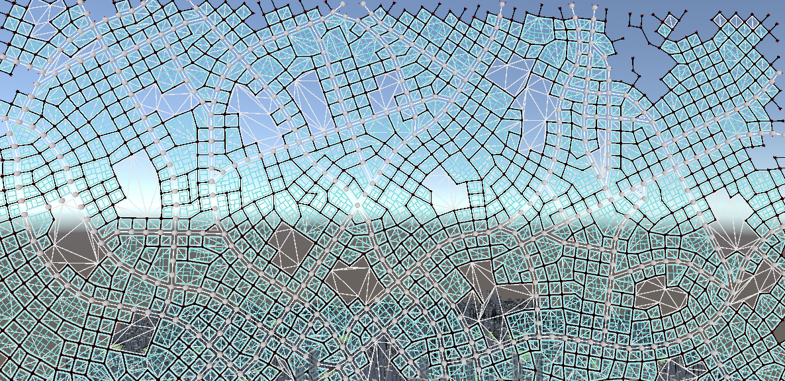
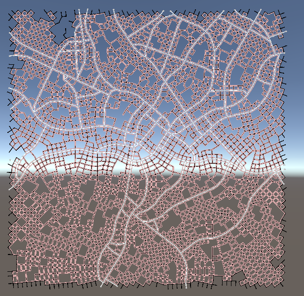
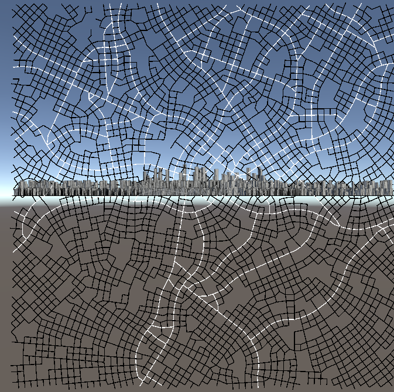
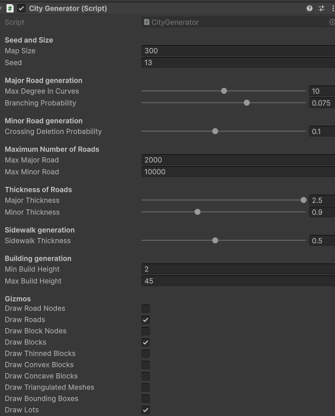
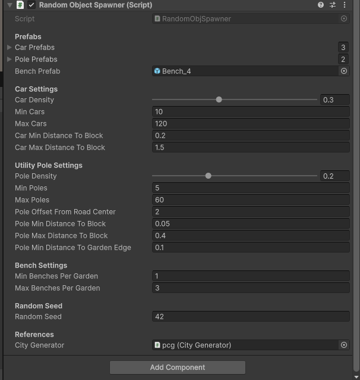

# CityScanPCG

**English** | [简体中文](README.zh-CN.md)

CityScanPCG is a Unity C# procedural city-scene generator. It turns a map scale and generation settings into a connected road graph, road-defined blocks and lots, extruded building meshes, heuristic park areas, and optional street props. Its goal is to make configurable city layouts with varied scale, density, and road complexity, rather than place buildings uniformly across a flat grid.

## Problem, inputs, and outputs

The plugin addresses the repeated manual work of building large urban test and visualization scenes. It grows major roads with branching and gradual direction changes, fills the network with minor roads, derives blocks from road widths, subdivides buildable lots, and creates scene geometry. A separate spawner can add cars, roadside poles, and benches.

**Inputs:** a Unity scene with a `CityGenerator`, Inspector settings (map size, seed, road-growth limits and probabilities, road widths, sidewalk inset, and building-height inputs), and—if props are wanted—prefabs and `RandomObjectSpawner` settings. Coordinates and distances use Unity units. The current generator does not import GIS/OSM data, terrain, zoning maps, or user-drawn road layouts.

**Outputs:** an in-memory `Graph` of major and minor roads plus block/lot data, and runtime Unity objects named `Road Plane`, `Block Container`, and `Lot Container`, with meshes, renderers, and colliders. Parks are rendered as green flat blocks; buildings are extruded lot meshes. Optional prefab instances are parented under the road plane.

**Intended use:** the included workflow is runtime generation inside a Unity scene, configured through Inspector fields. The generated scene can serve as a visualization or as a starting environment for a simulation project. This release does not define a standalone map-export format or a simulator integration API; the surrounding prototype's readiness notification is not a geometry-transfer interface.

**How to judge a successful generation:** in the demo, inspect the generated road graph, non-empty block/lot geometry, and the visible scene objects and colliders; check that road gaps, building lots, and green park blocks appear without generation errors. The screenshots below document a successful visual run. There is no automated quality gate or benchmark in this repository. Also, `GenerationComplete` currently becomes true immediately before main-thread GameObject creation starts, so it must not be treated as proof that the scene is fully materialized.

## Demonstration

The following images and video are captures supplied from a Unity run. The Inspector values are the configured values shown in those captures; `CityGenerator` perturbs 11 city parameters by about ±10% at startup, so the displayed values are not necessarily the effective values used for that run.

### Generated city and lot layout

The city view shows extruded gray building volumes, road space, and flat green areas. The lot and network views show the generated layout and its Gizmos from top-down and side-on angles.











[Watch the road-network generation video](media/video/road-network-generation.mp4)

### Settings shown in the captures

| Component | Inspector values shown | What they control |
|---|---|---|
| `CityGenerator` | `mapSize` 300; `seed` 13 | Initial map extent and city random source. The road plane spans approximately −300 to +300 on each horizontal axis before startup perturbation. |
| Major roads | `maxDegreeInCurves` 10; `branchingProbability` 0.075; `maxMajorRoad` 2,000 | Direction-change range, branch control, and a segment cap. Caps are upper bounds, not promised road counts. |
| Minor roads | `crossingDeletionProbability` 0.1; `maxMinorRoad` 10,000 | Minor-road cleanup probability and a segment cap. |
| Road/block dimensions | `majorThickness` 2.5; `minorThickness` 0.9; `sidewalkThickness` 0.5 | Road-width offsets used to derive block outlines and their inset buildable areas. |
| Building height inputs | `minBuildHeight` 2; `maxBuildHeight` 45 | Inputs to lot-height assignment. The current implementation does not guarantee every final height stays within these values. |
| `RandomObjectSpawner` | car density 0.3, min/max 10/120; pole density 0.2, min/max 5/60; pole road-center offset 2; benches per garden 1–3; `randomSeed` 42 | Optional prop placement controls. The capture also shows car/block distances 0.2–1.5, pole/block distances 0.05–0.4, garden-edge distance 0.1, three car prefabs, two pole prefabs, and `Bench_4`. |





## Generation pipeline

```mermaid
flowchart LR
    A[Seed and Inspector settings] --> B[Major-road growth]
    B --> C[Minor-road growth and cleanup]
    C --> D[Road graph]
    D --> E[Road-offset block outlines]
    E --> F[Sidewalk inset and recursive lot division]
    F --> G[Polygon triangulation and extrusion]
    G --> H[Main-thread Unity scene objects]
    H --> I[Optional cars, poles, and benches]
```



Major roads use a fixed 10-Unity-unit segment length, probabilistic branches, and periodic direction changes, with endpoint snapping, intersection checks, map bounds, and node-degree constraints. Minor roads grow from the major network and are cleaned up using crossing-deletion rules. The design is inspired by extended L-system road growth, but the implementation is explicit rule-based growth, not a general L-system parser.

Road widths are used to offset block boundaries. The block outlines are inset for sidewalk/buildable space, then cut recursively to form lots. The current lot divider chooses cut positions from 30%, 40%, 50%, or 60% of a bounding-rectangle edge, with at most six subdivision rounds; candidate subdivision is rejected for bounding-rectangle area under 10 Unity units² or aspect ratio over 4. Convex polygons use fan triangulation and concave polygons use ear clipping; the resulting top and side faces are used for meshes and colliders.

Blocks with more than 10 boundary vertices are tagged as parks by a geometric heuristic. This creates non-building green areas in the demonstrated city, but it is not semantic land-use classification: the plugin does not currently accept a Garden/zoning label or guarantee park distribution or urban-planning plausibility. “More realistic” is the design goal; the captures demonstrate varied road/block layouts and green areas, not a validated realism score.

## `MajorGenerator` constructor

`MajorGenerator` is an internal road-growth class. The constructor receives:

| Argument | Meaning |
|---|---|
| `seededRandom` | A `System.Random` instance created from the city seed and shared with later generation stages. It is a random generator object, not the integer seed. The same seed supports controlled random input, while full-scene repeatability has not been verified. |
| `mapSize` | Road growth is checked against a border centered at the origin, spanning `[-mapSize, +mapSize]` on each horizontal axis. |
| `maxRoad` | Maximum number of accepted major-road segments. It is a stopping cap, not a target count. |
| `maxDegree` | Maximum direction-change/lean parameter in degrees. Despite the name, this is not graph node degree; node connectivity is separately constrained to at most four edges. |
| `branchingChance` | Probability-like control used by the branch-selection rule to add a left branch, right branch, or both. Its effective behavior is quantized by integer random buckets and range clamps. |
| `graphToBuild` | The mutable `Graph` that receives generated major-road nodes and edges; later stages add minor roads and derive blocks from it. |

## Quick start

1. Open a Unity 2023.2 project.
2. Copy `Assets/CityScanPCG` into the project's `Assets` directory and allow Unity to import the scripts and materials.
3. Add `CityGenerator` to an empty GameObject and configure its Inspector fields.
4. Enter Play mode to generate the city objects at runtime.
5. To place props, add `RandomObjectSpawner`, assign the `CityGenerator`, and provide the required car, pole, and bench prefabs.

When replacing the original `CityPCG` folder in an existing project, remove the old copy before adding this one. Unity asset GUIDs are preserved in this source release. Prop prefabs are supplied by the consuming project; third-party model packs from the original development project are not included.

## Technology and limits

- Unity 2023.2 (source project version: 2023.2.20f1c1), C#, and UnityEngine
- Graph-based road representation and computational geometry
- Procedural `Mesh`, `System.Random`, a background `Thread`, and Unity coroutines
- Inspector controls and Gizmos for road, block, triangulation, lot, and bounding-box inspection

Road, lot, and background-computation durations are logged, but the city timer stops before main-thread GameObject, mesh, renderer, and collider creation. This repository contains no benchmark log, frame-rate or memory result, automated CityScanPCG tests, or quantified visual-quality evaluation. Objects are created individually on the main thread; GPU instancing, pooling, mesh combining, LOD, and Jobs/Burst are not implemented. Treat performance, output counts, placement quality, and complete-scene repeatability as unmeasured until profiled in a specified Unity Player build and on recorded hardware.

## Repository layout

```text
Assets/CityScanPCG/   Unity plugin source and materials
media/screenshots/   Unity output and Inspector captures
media/video/         Road-network generation capture
```

## License

CityScanPCG is released under the MIT License. See [LICENSE](LICENSE) and [THIRD_PARTY_NOTICES.md](THIRD_PARTY_NOTICES.md) for license and upstream attribution details.
